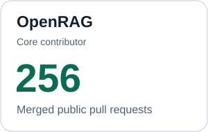
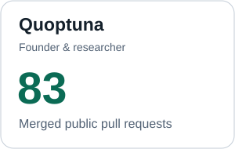

<picture>
  <source media="(prefers-color-scheme: dark)" srcset="assets/profile/header-dark.svg">
  
</picture>

I'm a **Software Engineer at IBM** with a **PhD in Computer Science from Western Michigan University**, specializing in quantum machine learning. I work across research, system design and hands-on engineering to turn AI ideas into useful software.

[LinkedIn](https://www.linkedin.com/in/edwinjosechittilappilly/) · [Google Scholar](https://scholar.google.com/citations?user=ixU11F4AAAAJ) · [ORCID](https://orcid.org/0000-0001-5199-8366) · [Email](mailto:edwin.jose@wmich.edu)

## Building in the open

<!-- public-contributions:start -->
Merged pull requests in selected public projects. Updated 2026-10-20 UTC.

<a href="https://github.com/search?q=repo%3Alangflow-ai%2Flangflow+author%3Aedwinjosechittilappilly+is%3Apr+is%3Amerged+is%3Apublic&amp;type=pullrequests"><picture><source media="(prefers-color-scheme: dark)" srcset="assets/profile/langflow-dark.svg"></picture></a>
<a href="https://github.com/search?q=repo%3Alangflow-ai%2Fopenrag+author%3Aedwinjosechittilappilly+is%3Apr+is%3Amerged+is%3Apublic&amp;type=pullrequests"><picture><source media="(prefers-color-scheme: dark)" srcset="assets/profile/openrag-dark.svg"></picture></a>
<a href="https://github.com/search?q=repo%3AQentora%2Fquoptuna+author%3Aedwinjosechittilappilly+is%3Apr+is%3Amerged+is%3Apublic&amp;type=pullrequests"><picture><source media="(prefers-color-scheme: dark)" srcset="assets/profile/quoptuna-dark.svg"></picture></a>
<!-- public-contributions:end -->

## Open-source work

| Project | My role & contributions |
|---|---|
| **[OpenRAG](https://github.com/langflow-ai/openrag)** | **Core contributor** — retrieval and orchestration, configuration, reproducible environments and developer documentation. |
| **[Langflow](https://github.com/langflow-ai/langflow)** | **Contributor** — agent systems, Model Context Protocol integrations, backend components, testing and contributor collaboration. |
| **[Quoptuna](https://github.com/Qentora/quoptuna)** | **Founder & first-author researcher** — explainable quantum machine learning, hyperparameter optimization, backend and interface development. |

## How I work

I start with the problem, the people using the system and the constraints around it. I make architectural trade-offs explicit, test uncertain ideas through focused experiments, and build interfaces and workflows that teams can understand and maintain. I value collaborative problem-solving, mentoring and sharing the context behind technical decisions.

## Research

My interests span **explainable quantum machine learning, optimization and AI education**.

Selected publication: **[Quoptuna: An Open-Source Framework for Explainable Quantum Machine Learning](https://doi.org/10.1109/INTCEC65580.2025.11256089)** — Edwin Jose and A. C. Fong, IEEE INTCEC, 2025.

[Browse my publications on Google Scholar →](https://scholar.google.com/citations?user=ixU11F4AAAAJ)

## Recognition

- **IBM Outstanding Technical Achievement Award** and **TCAP Leader Award**, 2026.
- **[IBM Open Source Strategic Committer](https://www.credly.com/badges/7d3ca379-3edd-4765-b90c-b964ff041a8f/)** credential.

## Technical toolkit

- **AI workflows:** Python, Langflow, LangChain, MCP, Hugging Face, Transformers.
- **Services & deployment:** FastAPI, Flask, Docker, AWS, MongoDB.
- **Experiments & optimization:** scikit-learn, TensorFlow, Keras, Optuna, Hyperopt, Matplotlib.
- **Quantum learning:** PennyLane, Qiskit, quantum machine learning.
