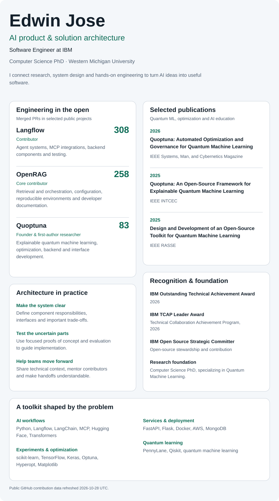

<!-- profile-overview:start -->
<picture>
  <source media="(max-width: 600px) and (prefers-color-scheme: dark)" srcset="assets/profile/profile-mobile-dark.svg">
  <source media="(max-width: 600px)" srcset="assets/profile/profile-mobile-light.svg">
  <source media="(prefers-color-scheme: dark)" srcset="assets/profile/profile-desktop-dark.svg">
  
</picture>
<!-- profile-overview:end -->

  <a href="https://edwinjosechittilappilly.github.io/edwinjosechittilappilly/">Portfolio</a> ·
  <a href="https://edwinjosechittilappilly.github.io/edwinjosechittilappilly/publications.html">All publications</a> ·
  <a href="https://scholar.google.com/citations?user=ixU11F4AAAAJ">Google Scholar</a> ·
  <a href="https://www.linkedin.com/in/edwinjosechittilappilly/">LinkedIn</a> ·
  <a href="mailto:edwin.jose@wmich.edu">Email</a>

  Selected papers:
  <a href="https://doi.org/10.1109/MSMC.2025.3613072">Quoptuna · IEEE Magazine, 2026</a> ·
  <a href="https://doi.org/10.1109/INTCEC65580.2025.11256089">Explainable QML · INTCEC, 2025</a> ·
  <a href="https://doi.org/10.1109/RASSE64831.2025.11315342">Open-source toolkit · RASSE, 2025</a>

